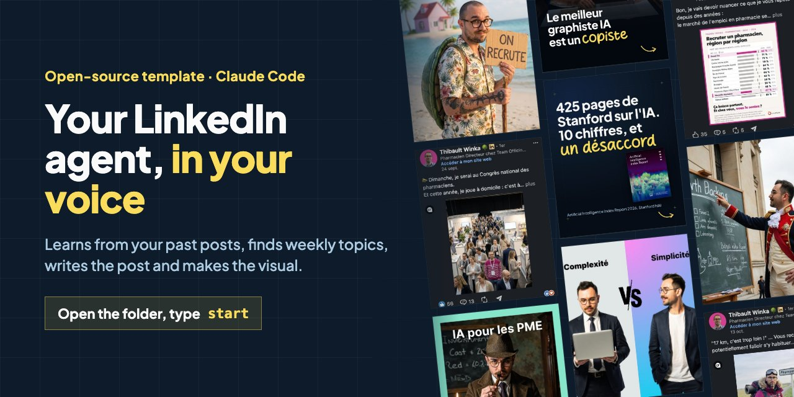
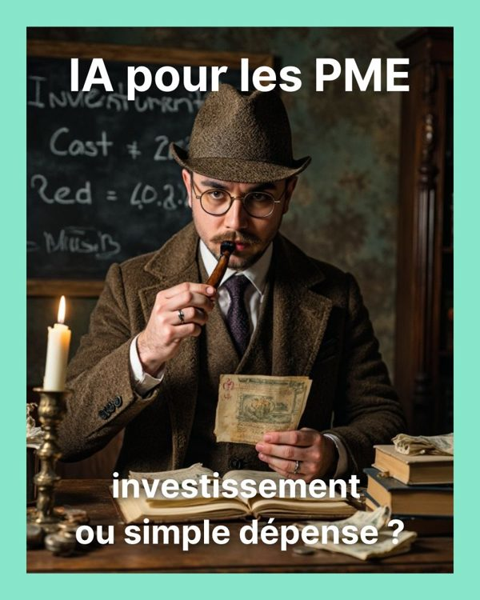
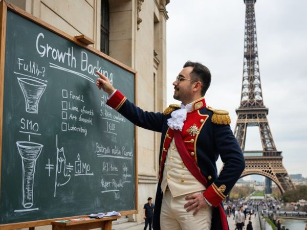
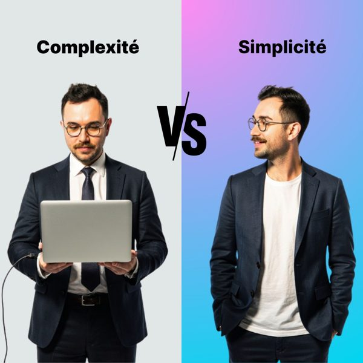
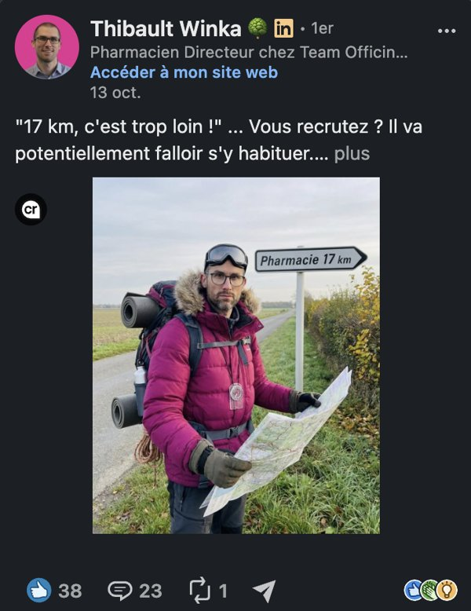
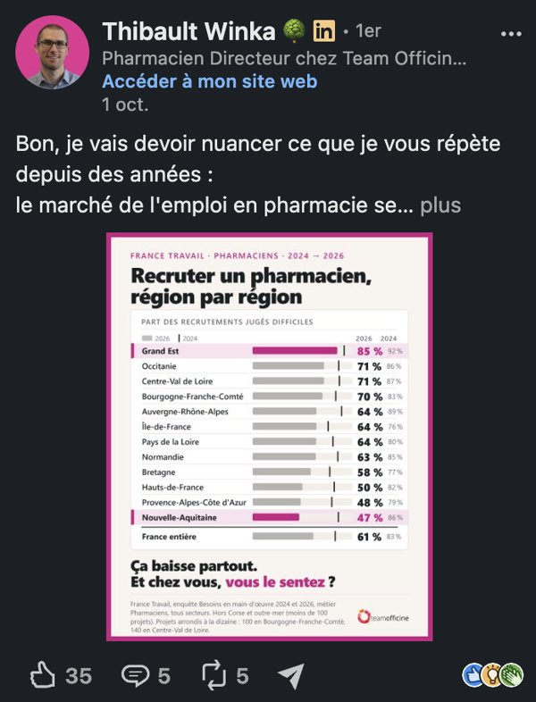
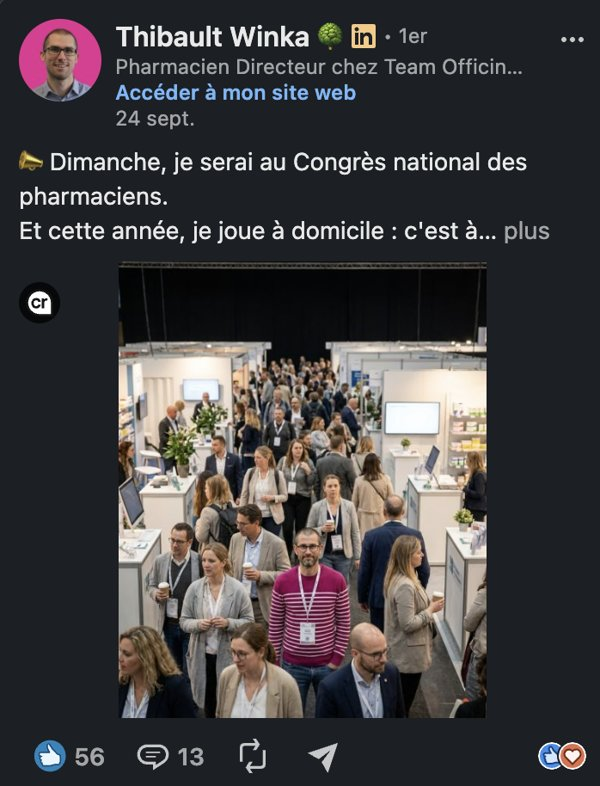

# LinkedIn agent for Claude Code: posts in your voice, visuals, weekly topic ideas



**A personal LinkedIn agent template for Claude Code / Cowork.** You open it, type `start`, and a guided 30-minute onboarding calibrates it on *you*: it fetches your past posts to learn your voice and what performs, sets up your audience and visual style, takes 3 photos of you to put you in custom images, connects an image generator, and installs a weekly content watch that brings you topic ideas without you asking.

After that, it writes posts that sound like you and produces the visuals to go with them (AI images with you in the scene, cards, carousels).

## What it makes: real posts

Visuals published on LinkedIn by people who use this agent, unedited.

**[Jessy Martin](https://www.linkedin.com/in/jessy-martin/)**, author of the template: AI scenes where he plays the part, carousels, cards.

<table>
  <tr>
    <td width="33%"><br><sub>AI scene, recruiting post: his best of his last 20 posts, 12× his median engagement</sub></td>
    <td width="33%"><br><sub>Carousel cover (9 pages)</sub></td>
    <td width="33%"><br><sub>Carousel cover (18 pages), from a report</sub></td>
  </tr>
  <tr>
    <td><br><sub>Card: hook on top, question at the bottom</sub></td>
    <td><br><sub>AI scene: a pop-culture remix</sub></td>
    <td><br><sub>Split card for a comparison post</sub></td>
  </tr>
</table>

**[Thibault Winka](https://www.linkedin.com/in/thibault-winka/)**, pharmacist and CEO of Team Officine, with his own agent:

<table>
  <tr>
    <td width="33%"><br><sub>AI scene with his face: 56 likes, 13 comments</sub></td>
    <td width="33%"><br><sub>Data card from France Travail figures, sourced at the bottom</sub></td>
    <td width="33%"><br><sub>AI scene on a recruiting topic: 23 comments</sub></td>
  </tr>
</table>

## Load it into Claude (copy-paste)

**Option A: the Claude desktop app (easiest).** Download the ZIP from the green **Code** button, unzip it, open the folder in the Claude desktop app (**Code** tab), and type `start`.

**Option B: clone and open in the terminal:**

```bash
git clone https://github.com/Littlpinguin/linkedin-agent-template.git my-linkedin-agent
cd my-linkedin-agent
claude
```

Then type:

```
start
```

The agent reads `CLAUDE.md`, sees it isn't configured yet, and launches its onboarding.

**Option C: your own private copy with the GitHub CLI:**

```bash
gh repo create my-linkedin-agent --template Littlpinguin/linkedin-agent-template --private --clone && cd my-linkedin-agent && claude
```

Keep that repo **private**: once configured, it describes you (voice, audience, content watch). Your photos are excluded from git anyway.

> Using **Cowork**? Open the folder and type `start`. Some steps need network access and a headless browser; if they're not available, the onboarding switches to the routes that work (see Requirements).
>
> Don't have Claude Code yet? See [claude.com/claude-code](https://claude.com/claude-code).

## What the onboarding does

Ten steps, one question at a time. You can skip a step, stop, and pick up later (`resume`): progress is saved in `profile/config.md`. For every tool, the agent offers three routes, including a free one, and says what each can and can't do.

1. **Welcome and setup check**: what's coming, what to have at hand, and a silent check of Python, Playwright and network access.
2. **You and your business**: your LinkedIn profile URL and website, analyzed for offer, audience and tone.
3. **Your past posts**, three routes:
   - **Apify, driven by the agent (recommended)**: you paste your Apify token into `.env`, the agent runs `scripts/scrape-linkedin-posts.py` and gets text + likes + comments + shares + the format of each post (text, image, carousel, video, link), plus your post visuals (images, carousel pages, video thumbnails) downloaded for free from LinkedIn. The only route with engagement and format data. Free credits on sign-up, then paid per post. Only on your own profile, within LinkedIn's terms.
   - **LinkedIn's official export** (free): *Settings → Data privacy → Get a copy of your data → Posts*. No engagement data, can take up to 24 h.
   - **Copy-paste** 15+ posts (free).
4. **Your voice, played back**: 3 real hooks that worked, your best registers, your writing tics. You correct, then it writes your editorial identity (`voice/identite-editoriale.md`) and your winning recipe (`profile/recette.md`).
5. **Your audience**: five questions (who, their problem, what they read, what makes them hesitate, what they should do after reading), written to `profile/cible.md`.
6. **Your visual style**: from the visuals of your best-performing posts (fetched at step 3) and/or 3-4 post visuals you like, in `assets/references-visuelles/` → `profile/style-visuel.md`.
7. **Your 3 photos**: one front-facing (`face.jpg`), one with your nose pointing to the left edge of the picture (`nez-a-gauche.jpg`), one with your nose pointing to the right edge (`nez-a-droite.jpg`), in `assets/moi/`. iPhone `.heic` photos are converted for you. The agent checks each one, asks again if it won't work, and asks for your consent.
8. **Image generation**, three routes:
   - **Google AI Studio key** (Nano Banana 2.1), the most integrated;
   - **a connector already plugged into Claude: Magnific or Higgsfield**. Want to try Magnific? Here's the template author's referral link: [referral.magnific.com/mzV9vem](https://referral.magnific.com/mzV9vem);
   - **no AI generation** (free): cards and carousels with your real photos.

   A paid test image only runs if you say yes.
9. **Your content watch**: the agent suggests axes and real sources for your niche, runs a first watch live (5 sourced topic ideas), then schedules it weekly: a scheduled task in the Claude app, a Claude Code cloud routine (needs a private GitHub repo), or n8n.
10. **Wrap-up**: a 5-line recap, then "Shall we write your first post?"

## Requirements

- **Claude Code** (desktop app or terminal) or **Cowork**.
- **Python 3** with `python3 -m pip install requests` (post fetching, image generation) and `python3 -m pip install playwright && python3 -m playwright install chromium` (cards and carousels). `pdftoppm` (poppler, `brew install poppler`) for print-sharp carousel PDFs.
- **Optional keys** in `.env` (copy `.env.example`): `APIFY_TOKEN`, `GOOGLE_AI_API_KEY`. Never paste a key into the chat: write it in `.env` and tell the agent "done".
- **In a restricted environment** (Cowork, sandbox without network): Apify, Google generation and Chromium may fail. The onboarding detects it and uses LinkedIn's export or copy-paste, an image connector, and HTML cards to open in your browser.

## The production chain (after setup)

1. **Find**: `veille-contenu` brings the week's topic ideas, sourced, dated and deduplicated against a journal (no idea comes back for 8 weeks once published).
2. **Write**: `my-viral-post` proposes angles in your voice, from your recipe and your last 5 approved posts, assembles the post, tells you which visual to attach, and logs it.
3. **Illustrate**: `image-linkedin` puts you in the scene (remixed reference, meme), picking the photo whose angle matches the scene.
4. **Compose and export**: `carte-linkedin` (PNG 1080×1350) or `carrousel-linkedin` (rasterized PDF, sharp in every viewer).
5. **Track**: every post and visual goes into `outputs/registry.csv` with a status: draft → to review → approved → scheduled → published.

## Structure

```
linkedin-agent-template/
├── CLAUDE.md                    ← the orchestrator (rules, onboarding trigger, unread watch)
├── skills/
│   ├── onboarding/              ← 10-step guided setup, resumable, upgrades v1 agents
│   ├── veille-contenu/          ← weekly content watch (parallel sub-agents, anti-repeat journal)
│   ├── my-viral-post/           ← writes the post (text)
│   ├── image-linkedin/          ← you in AI images (Google key or Magnific / Higgsfield connector)
│   ├── carte-linkedin/          ← single-image card / infographic (HTML→PNG)
│   └── carrousel-linkedin/      ← multipage carousel (HTML→PDF), source of design tokens
├── voice/
│   ├── identite-editoriale.md   ← YOUR voice (written during onboarding)
│   ├── anti-ai-writing-style.md ← universal anti-AI writing rules
│   ├── bibliotheque-hooks-texte.md   ← evidence-graded text hooks
│   └── bibliotheque-hooks-visuels.md ← evidence-graded visual hooks
├── profile/
│   ├── config.md                ← your variables, tools, onboarding progress
│   ├── recette.md               ← what performs for you, with numbers
│   ├── cible.md                 ← your audience
│   ├── veille.md                ← your watch: axes, sources, schedule
│   └── style-visuel.md          ← YOUR visual style
├── veille/                      ← dated watch reports + anti-repeat journal (versioned)
├── assets/
│   ├── moi/                     ← your 3 photos (excluded from git)
│   ├── marque/                  ← your kit (logo, fonts, icons), optional
│   ├── references-visuelles/    ← 3-4 visuals you like
│   ├── visuels-generes/         ← raw AI images (TONE reference)
│   └── visuels-posts/           ← finished posts (COMPOSITION reference)
├── scripts/                     ← scrape-linkedin-posts.py, gen-image.py, screenshot.py,
│                                  export-carousel-pdf.py, journal.py
├── templates/                   ← carousel-linkedin-base.html
├── docs/                        ← template design notes
└── .env.example                 ← optional keys (Apify, Google)
```

> The agent's doctrine is written in French (it grew out of a French personal-branding agent), but it learns its voice from *your* posts, so it adapts to your language. The trigger word works in any language (`start`, `begin`, `commencer`, `setup`…).

## Already using the first version?

Get the new version **without overwriting the files the onboarding filled in**: `profile/*.md`, `voice/identite-editoriale.md`, `veille/` and `assets/`.

- With git, in your agent's folder. First save your current setup (your photos stay out of the commit):

  ```bash
  git add -A -- . ':!assets/moi' && git commit -m "My agent before the update"
  ```

  Then fetch the new version:

  ```bash
  git pull --no-rebase --no-edit
  ```

  If git reports conflicts, keep your own files and take the template's `CLAUDE.md`:

  ```bash
  git checkout --ours profile/ voice/identite-editoriale.md && git checkout --theirs CLAUDE.md && git add -A -- . ':!assets/moi' && git commit --no-edit
  ```

  (If you get "Your local changes would be overwritten", the first command was skipped. If you get "Need to specify how to reconcile divergent branches", `--no-rebase` was missing.)
- From a ZIP: copy everything from the new version **except** your existing files in `profile/`, `voice/identite-editoriale.md`, `veille/` and `assets/`. Do copy the new `profile/` files you don't have yet (`recette.md`, `cible.md`, `veille.md`).

Then open the folder and say `update my agent`. The onboarding runs in upgrade mode: it keeps your editorial identity, moves your recipe to `profile/recette.md`, and only plays the new steps (audience, 3 photos, image generation, content watch). Your old `visage-*` photos still work. If you had committed them, the agent helps you untrack them (the first version didn't exclude them from git). The onboarding no longer edits `README.md` or `CLAUDE.md`, so future updates won't conflict.

## What makes this template different

- **It knows what performs for you**: your recipe comes from your own posts and their numbers, not from generic LinkedIn advice.
- **It never runs out of ideas**: a weekly watch on your niche, sourced and deduplicated, ready to turn into a post.
- **Pure personal branding**: your face in the images, from 3 angles. No secondary brand, no mascot.
- **No imposed frame**: your visual style is inferred from visuals you like, so your posts look like *you*.
- **Anti "AI slop"**: bans hype jargon, negative parallelisms ("it's not X, it's Y"), em dashes, and enforces a concrete, number-driven voice.
- **Honest about tools**: three routes for every tool, one of them free, with their limits stated. No paid generation without your yes.
- **Self-contained**: everything stays inside the folder.

## Security

- Never commit `.env` (covered by `.gitignore`), never paste a key into the chat.
- Your photos (`assets/moi/`) are excluded from git. Only your own face, with your consent. No other real person without permission.
- Keep your configured agent in a **private** repo.
- Third-party logos: never fabricate them with AI or scrape them. Ask for the official files.

## License

[MIT](LICENSE). Reuse, modify, redistribute freely.
